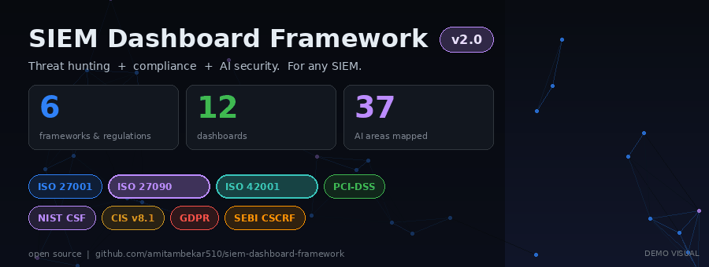
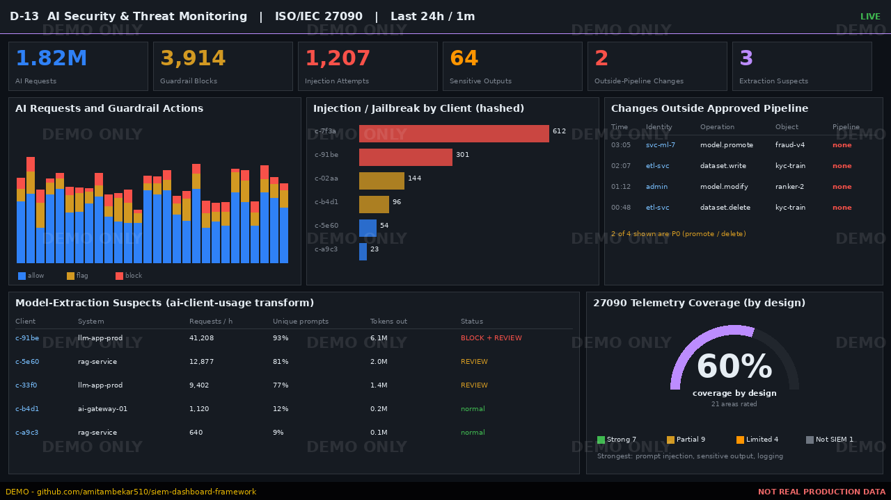
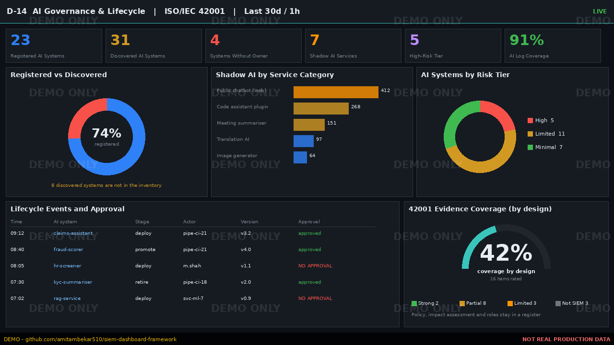
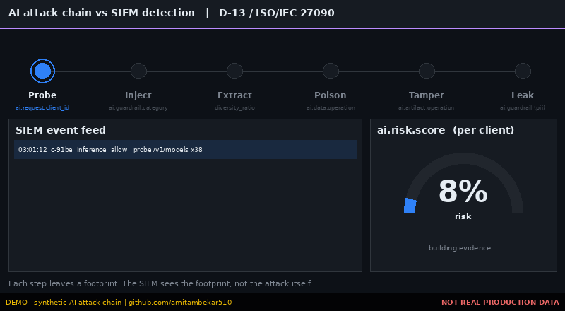
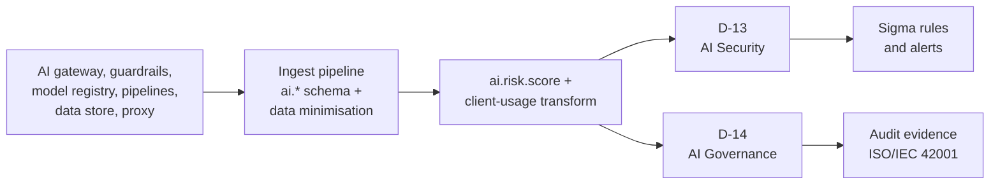
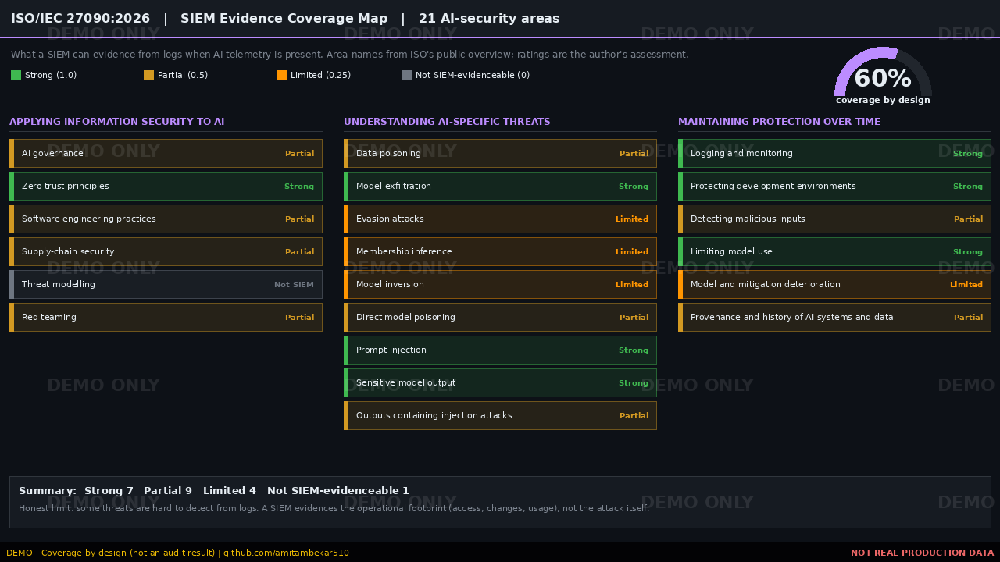
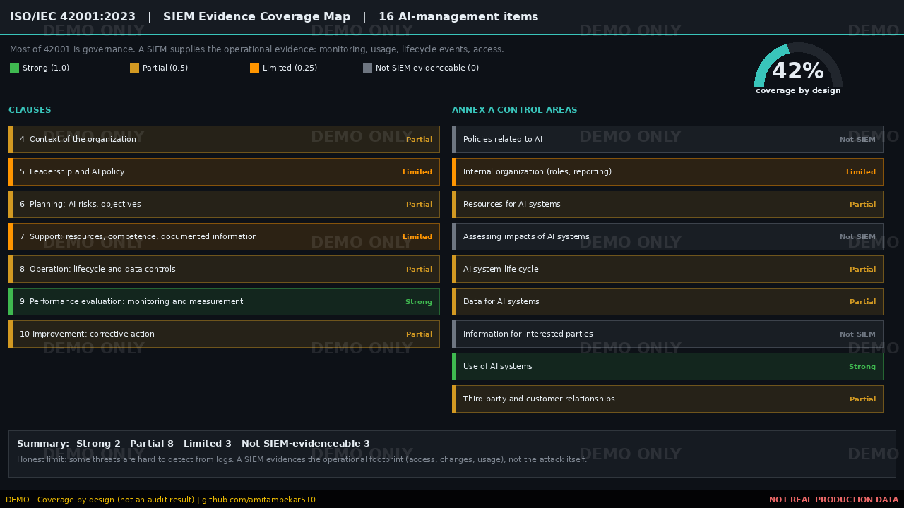

<div align="center">

# 🛡️ Universal SIEM Dashboard Framework

### 14 production-grade dashboards for threat hunting, compliance **and AI security**, for any SIEM




<sub>⚠️ Demo visuals are synthetic and watermarked. No real production or client data appears in this repository.</sub>

**[Live showcase](https://amitambekar510.github.io/siem-dashboard-framework/)** · **[Dashboard catalog](docs/dashboard-catalog.md)** · **[AI security (ISO/IEC 27090)](docs/iso-27090-ai-security.md)** · **[AI management (ISO/IEC 42001)](docs/iso-42001-ai-management.md)**

</div>

---

## 🆕 What's new in v2.0

| | |
|---|---|
| 🤖 **ISO/IEC 27090:2026** | Security threats to AI systems: 21-area SIEM coverage map, hunt playbook, queries, Sigma rules |
| 🧭 **ISO/IEC 42001:2023** | AI management system: 16-item coverage map and audit-evidence guide |
| 📊 **2 new dashboards** | **D-13** AI Security & Threat Monitoring · **D-14** AI Governance & Lifecycle |
| 🧱 **`ai.*` telemetry schema** | 27 proposed vendor-neutral fields, index template, gateway pipeline, shadow-AI pipeline |
| 🧪 **Portable detections** | 5 Sigma rules for AI attacks and misuse |
| ✅ **Current versions** | PCI DSS **v4.0.1** (v4.0 retired) · CIS Controls **v8.1** |
| 🎞️ **New visuals** | Hero animation, AI attack-chain GIF, 14-dashboard tour, coverage maps |

Full list: [CHANGELOG.md](CHANGELOG.md)

---

## 🎯 Why this project exists

Most SIEMs ingest millions of events yet give analysts **no clear view of what matters**. Analysts pivot across five tools to answer one question, compliance evidence is assembled by hand before every audit, silent log sources go unnoticed, and now **AI systems add an attack surface most SOCs cannot see at all**.

> **What should a SOC dashboard suite show, so an analyst sees every critical event in a single window, including events from AI systems?**

This is the outcome of a real long-term SOC engagement (900M+ events, Linux + Windows, multiple frameworks), generalised into a **vendor-neutral** reference. Field names follow ECS and every query is easy to translate to SPL, Sentinel KQL or AQL.

---

## 🖼️ Preview

<table>
<tr>
<td width="50%"><br/><sub><b>D-13</b> AI Security & Threat Monitoring (ISO/IEC 27090)</sub></td>
<td width="50%"><br/><sub><b>D-14</b> AI Governance & Lifecycle (ISO/IEC 42001)</sub></td>
</tr>
<tr>
<td width="50%"><br/><sub><b>D-11</b> Compliance & Audit across 8 frameworks</sub></td>
<td width="50%"><br/><sub><b>D-01</b> SOC Alert Triage & Overview</sub></td>
</tr>
</table>

### 🤖 An AI attack chain, as the SIEM sees it

<div align="center"></div>

### 🔴 Threat hunting: host and AI signals in one window

<div align="center"></div>

### 🎬 Tour of the dashboards

<div align="center"></div>

---

## 🗂️ The 14 dashboards (99 panel designs)

| Ref | Dashboard | Audience | Purpose | Priority | Range / Refresh |
|---|---|---|---|---|---|
| **D-01** | SOC Alert Triage / Overview | L1/L2 Analysts | Real-time triage of the day's alerts | 🔴 P1 | Last 24h / 30s |
| **D-02** | Ingest & Source Health | SOC Eng / Platform | Confirm every source is alive and flowing | 🔴 P1 | Last 24h / 1m |
| **D-03** | Cluster Health / Infrastructure | Platform Admin | Keep the stack healthy | 🔴 P1 | Last 24h / 30s |
| **D-04** | Authentication & Identity | Analysts | Spot identity-based attacks | 🔴 P1 | Last 24h / 1m |
| **D-05** | Network Security | Analysts | Perimeter and network visibility | 🔴 P1 | Last 24h / 1m |
| **D-06** | Endpoint / EDR | Analysts | Host-level threat visibility | 🟠 P2 | Last 24h / 1m |
| **D-07** | MITRE ATT&CK Coverage | SOC Lead / Detection Eng | See detection coverage and gaps | 🟠 P2 | Last 30d / on demand |
| **D-08** | Threat Intelligence | Analysts | Track IOC matches | 🟠 P2 | Last 7d / 5m |
| **D-09** | Detection Rule Performance | Detection Eng | Tune the ruleset | 🟠 P2 | Last 7d / 15m |
| **D-10** | Data Retention & ILM | Platform Admin | Storage governance | 🟠 P2 | Last 7d / 1h |
| **D-11** | Compliance & Audit | Compliance | Evidence for regulators across all 8 frameworks | 🟠 P2 | Last 30d / 1h |
| **D-12** | Executive / Client Report | Client | Business-level posture | 🟡 P3 | Last 30d / scheduled |
| **D-13** 🆕 | AI Security & Threat Monitoring | SOC / AI Security Eng | Detect attacks on AI systems (ISO/IEC 27090 areas) | 🟠 P2 | Last 24h / 1m |
| **D-14** 🆕 | AI Governance & Lifecycle | AI Governance / CISO / Compliance | Evidence for AI management (ISO/IEC 42001) | 🟠 P2 | Last 30d / 1h |

Panel-by-panel detail, data sources and build order: [`docs/dashboard-catalog.md`](docs/dashboard-catalog.md).

---

## ✅ 8 frameworks and regulations mapped

| # | Framework / regulation | Type | Scope | Added |
|---|---|---|---|---|
| 1 | **ISO/IEC 27001:2022** | International standard | Information security management system | v1.0 |
| 2 | **ISO/IEC 27090:2026** 🆕 | International standard (guidance) | Security threats and compromises to AI systems | v2.0 |
| 3 | **ISO/IEC 42001:2023** 🆕 | International standard | AI management system | v2.0 |
| 4 | **PCI DSS v4.0.1** | Industry standard | Payment card data security | v1.0 |
| 5 | **NIST CSF 2.0** | Framework | Cybersecurity risk management (Govern, Identify, Protect, Detect, Respond, Recover) | v1.0 |
| 6 | **CIS Controls v8.1** | Framework | Prioritised defensive safeguards (18 controls) | v1.0 |
| 7 | **GDPR** | Regulation (law) | Personal data protection | v1.0 |
| 8 | **SEBI CSCRF** | Regulatory framework | Cyber resilience for SEBI-regulated entities | v1.0 |

**Breakdown:** 3 ISO/IEC standards · 3 industry standards / frameworks · 2 regulatory. MITRE ATT&CK is used as a threat-mapping reference and is not counted.

> **Read the numbers correctly.** The six original frameworks show an *example scorecard* from one engagement. ISO/IEC 27090 and 42001 show **coverage by design** (what a SIEM can evidence), **not** an audit result. See [`docs/framework-coverage.md`](docs/framework-coverage.md).

---

## 🤖 AI security and governance (new in v2.0)

AI systems fail in ways ordinary dashboards cannot see: poisoned training data, stolen models, prompt injection, leaked output. ISO/IEC 27090 gives guidance on those threats, and ISO/IEC 42001 defines how an organisation manages AI. A SIEM cannot prove everything in either, but it can evidence a lot, **if the telemetry exists**.



<table>
<tr>
<td width="50%"><br/><sub><b>ISO/IEC 27090</b>: 21 areas, <b>60%</b> coverage by design</sub></td>
<td width="50%"><br/><sub><b>ISO/IEC 42001</b>: 16 items, <b>42%</b> coverage by design</sub></td>
</tr>
</table>

| Standard | Strong | Partial | Limited | Not SIEM-evidenceable | Coverage by design |
|---|---|---|---|---|---|
| ISO/IEC 27090:2026 (21 areas) | 7 | 9 | 4 | 1 | **60%** |
| ISO/IEC 42001:2023 (16 items) | 2 | 8 | 3 | 3 | **42%** |

**Honest limits:** evasion, model inversion and membership inference are weak SIEM signals, and most of 42001 (policy, impact assessment, roles) is governance, not logs. The framework says so openly, because that is what auditors trust.

**Privacy by design:** do not log raw prompts or completions by default. Hash prompts and API keys, keep token counts. See [`docs/ai-telemetry-schema.md`](docs/ai-telemetry-schema.md).

---

## 🕵️ Threat hunting in a single window

| Priority | Signal | Query | Source |
|---|---|---|---|
| 🔴 | Audit log cleared (must be 0) | `winlog.event_id: 1102` | Windows |
| 🔴 | Root-level operations | `auditd.log.EUID: "0"` | Linux |
| 🔴 | Privileged group change | `winlog.event_id: (4732 OR 4756)` | Windows |
| 🔴 | **Model changed outside pipeline** | `ai.artifact.operation: ("modify" OR "promote") AND NOT ai.pipeline.id: *` | AI |
| 🔴 | **Sensitive data in model output** | `ai.guardrail.category: ("pii" OR "secrets")` | AI |
| 🟠 | **Training data written outside pipeline** | `ai.data.operation: ("write" OR "delete") AND NOT ai.pipeline.id: *` | AI |
| 🟠 | **Prompt-injection burst** | `ai.guardrail.category: ("prompt_injection" OR "jailbreak")` | AI |
| 🟠 | Shared / unattributed account | `auditd.log.AUID: "4294967295"` | Linux |
| 🟡 | **Shadow AI usage** | `ai.shadow.detected: true` | Proxy |

**One query to hunt them all:**

```kql
(auditd.log.EUID: "0" AND auditd.log.success: "no")
OR winlog.event_id: (1102 OR 4732 OR 4756 OR 7045 OR 4698)
OR (event.outcome: "failure" AND rule.name: *)
OR auditd.log.AUID: "4294967295"
OR auditd.log.key: DPIA_*
OR (ai.artifact.operation: ("modify" OR "promote") AND NOT ai.pipeline.id: *)
OR ai.guardrail.category: ("pii" OR "secrets")
```

Playbooks: [host](docs/threat-hunting-playbook.md) · [AI](docs/ai-threat-hunting-playbook.md)

---

## 🧮 Risk-score model

| Host / identity signal | Weight | AI signal | Weight |
|---|---|---|---|
| Audit log cleared | ×10 | Model changed outside pipeline | ×9 |
| Privileged group change | ×8 | Sensitive output (PII / secrets) | ×8 |
| Shared account | ×7 | Dataset write outside pipeline | ×8 |
| DPIA-tagged access | ×6 | Prompt injection / jailbreak | ×6 |
| Root privilege / new service | ×5 | Shadow AI | ×4 |
| Rule-triggered failure | ×4 | Agent tool denied | ×3 |
| Auth failure | ×3 | | |

Scripts: [`scripts/risk-score.painless`](scripts/risk-score.painless) · [`scripts/ai-risk-score.painless`](scripts/ai-risk-score.painless)

---

## 🔌 Works with any SIEM

| SIEM | Query language | Notes |
|---|---|---|
| Elastic Security | KQL / ES\|QL | Reference implementation |
| Splunk ES | SPL | [`docs/siem-translation.md`](docs/siem-translation.md) |
| Microsoft Sentinel | KQL (Kusto) | Map ECS to ASIM |
| IBM QRadar | AQL | Custom properties |
| Google Chronicle | YARA-L | UDM mapping |
| Wazuh | OpenSearch DQL | Same index patterns |
| **Any SIEM** | **Sigma** | AI detections in [`sigma/`](sigma/) |

---

## 📁 Repository layout

```
siem-dashboard-framework/
├── README.md · index.html · LICENSE · CHANGELOG.md · CONTRIBUTING.md
├── assets/                  # watermarked demo images and GIFs
├── docs/
│   ├── dashboard-catalog.md          # D-01 to D-14
│   ├── framework-coverage.md         # 8 frameworks, scoring method
│   ├── iso-27090-ai-security.md      # NEW
│   ├── iso-42001-ai-management.md    # NEW
│   ├── ai-telemetry-schema.md        # NEW
│   ├── ai-threat-hunting-playbook.md # NEW
│   ├── threat-hunting-playbook.md
│   ├── gap-analysis.md
│   └── siem-translation.md
├── kql/                     # hunt, compliance, ai-security
├── scripts/                 # pipelines, template, transforms, painless
├── sigma/                   # 5 portable AI detection rules
└── excel/                   # SIEM_Dashboard_Framework_Extended_v2.xlsx
```

---

## 🚀 Quick start

1. Build the **P1 dashboards** first (D-01 to D-05) and **D-02 early**: a silent source defeats every other dashboard.
2. Confirm data sources in [`docs/dashboard-catalog.md`](docs/dashboard-catalog.md).
3. Import `scripts/` (pipelines, runtime fields, transforms).
4. For AI: deploy an AI gateway or proxy log, load the [`ai.*` template](scripts/index-template-ai-fields.json), apply the [gateway pipeline](scripts/ingest-pipeline-ai-gateway.json), then build **D-13 / D-14**.
5. Import the [Sigma rules](sigma/) into your SIEM's rule converter.
6. Use the Excel **Panel Builder** to configure each panel.

---

## 🗺️ Candidates for v2.x (feedback welcome, not promises)

EU AI Act mapping · NIST AI RMF · OWASP Top 10 for LLM applications · MITRE ATLAS technique mapping · India DPDP Act · CERT-In reporting timelines

---

## ⚖️ Disclaimer and independence

This project is **not affiliated with or endorsed by** ISO, IEC, PCI SSC, NIST, CIS, the EU or SEBI. It contains **no text from ISO/IEC standards**: topic names come from ISO's public overview pages and the mappings are the author's own paraphrase for orientation. Clause-level conformance work requires the licensed standards from [iso.org](https://www.iso.org/). Coverage figures are design estimates, not certification or audit results.

## 🤝 Contributing · 📜 License

See [CONTRIBUTING.md](CONTRIBUTING.md). Released under the [MIT License](LICENSE).

## 👤 Author

**Amit Ambekar**, SOC Analyst, Mumbai · [@amitambekar510](https://github.com/amitambekar510)

<div align="center"><sub>If this helped your SOC, give it a ⭐</sub></div>
