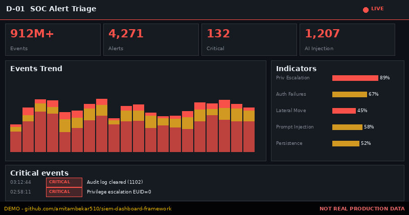
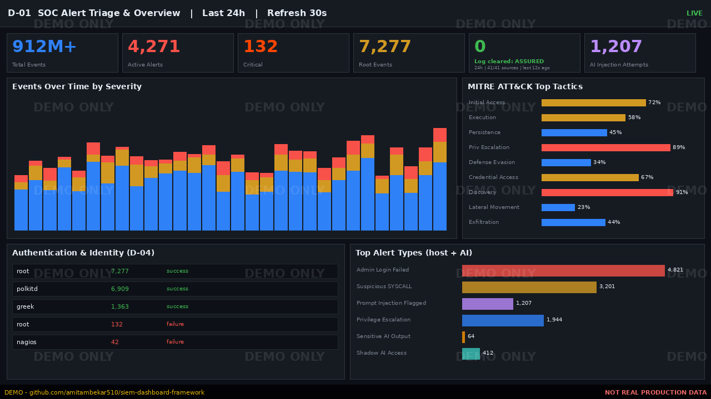
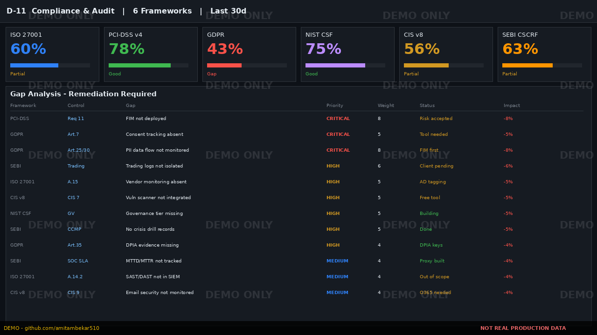
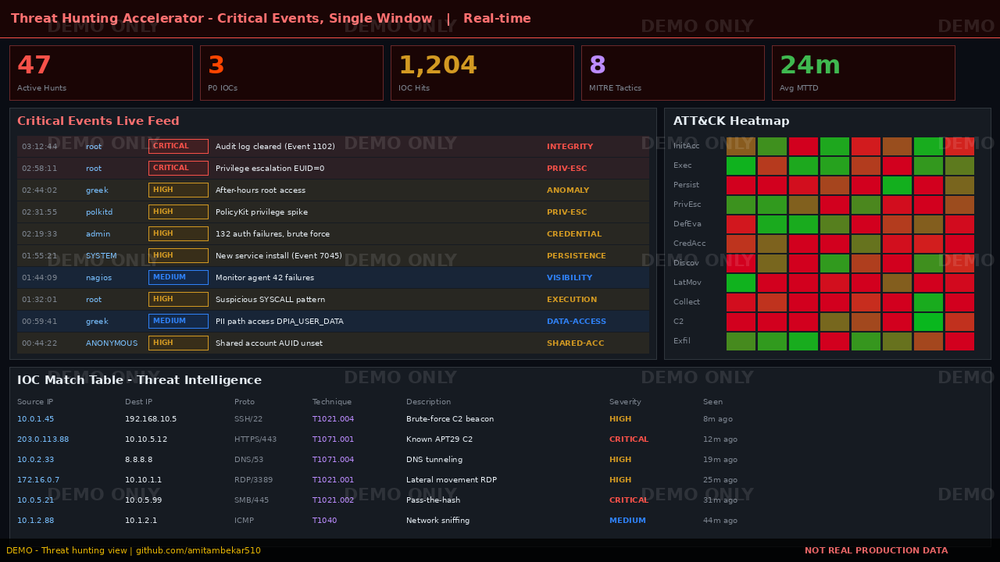
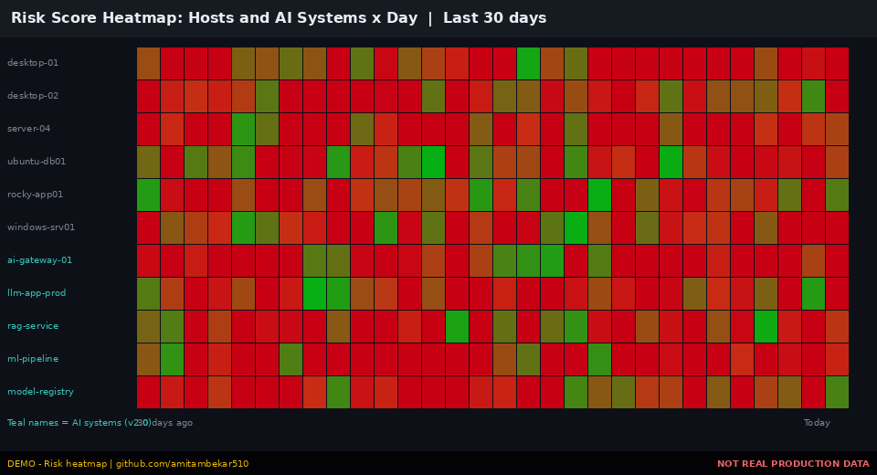
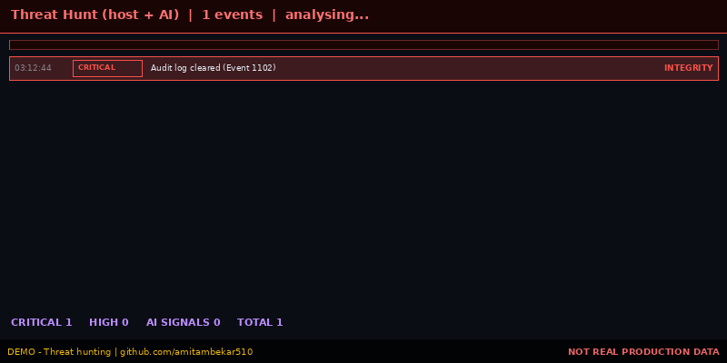
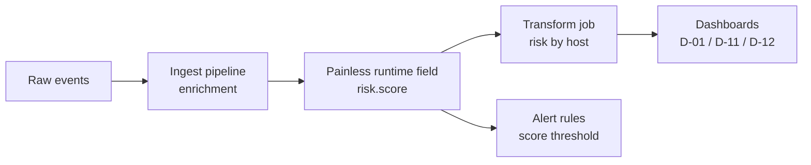
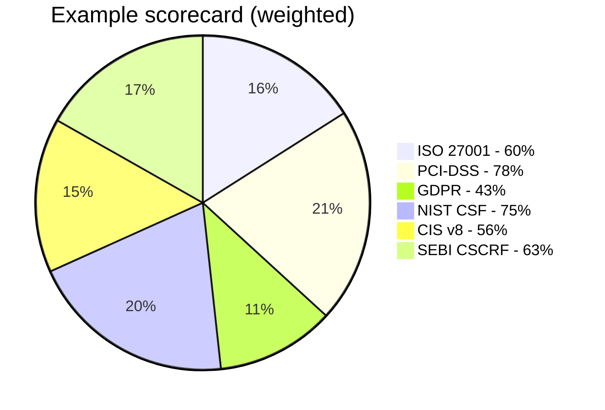

<div align="center">

# 🛡️ Universal SIEM Dashboard Framework

### 12 production-grade dashboards that cut threat-hunting time and prove compliance — for **any** SIEM




<sub>⚠️ Demo visuals generated for illustration. They are watermarked and contain no real production data.</sub>

</div>

---

## 🎯 Why this project exists

Most SIEM deployments ingest millions of events yet give analysts **no clear view of what matters**. Analysts pivot across five tools to answer one question, compliance evidence is assembled by hand before every audit, and silent log-source failures go unnoticed.

This framework answers one question:

> **What should a SOC dashboard suite show, so an analyst sees every critical event in a single window?**

It is the outcome of a real long-term SOC engagement (900M+ events, Linux + Windows, 6 compliance frameworks). The design is **vendor-neutral**. Field names follow ECS, and every query is easy to translate to SPL, KQL (Sentinel) or AQL.

---

## ⚡ What you get

| | |
|---|---|
| 📊 **12 dashboards** | From analyst triage to executive reporting, each with audience, purpose, data sources, refresh and priority |
| 🎯 **Threat-hunting window** | Critical signals ranked by severity and MITRE technique, in one view |
| 🧮 **Risk-score model** | Weighted per-event scoring (Painless script included) |
| ✅ **6 compliance frameworks** | ISO 27001 · PCI-DSS v4 · GDPR · NIST CSF 2.0 · CIS v8 · SEBI CSCRF |
| 🔍 **Honest gap analysis** | 24 gaps, weighted and prioritised, with remediation paths |
| 📁 **Ready-to-use assets** | KQL, ingest pipelines, auditd rules, transform jobs, Excel panel builder |

---

## 🖼️ Preview

<table>
<tr>
<td width="50%"><br/><sub><b>D-01</b> SOC Alert Triage & Overview</sub></td>
<td width="50%"><br/><sub><b>D-11</b> Compliance & Audit, six frameworks</sub></td>
</tr>
<tr>
<td width="50%"><br/><sub><b>Hunt window</b> critical events, ATT&CK heatmap, IOC table</sub></td>
<td width="50%"><br/><sub><b>Risk score</b> host × day heatmap</sub></td>
</tr>
</table>

### 🔴 Threat hunting, live view

<div align="center">

</div>

---

## 🗂️ The 12 dashboards

| Ref | Dashboard | Audience | Purpose | Priority | Range / Refresh |
|---|---|---|---|---|---|
| **D-01** | SOC Alert Triage / Overview | L1/L2 Analysts | Real-time triage of the day's alerts | 🔴 P1 | 24h / 30s |
| **D-02** | Ingest & Source Health | SOC Eng / Platform | Confirm every source is alive and flowing | 🔴 P1 | 24h / 1m |
| **D-03** | Cluster Health / Infrastructure | Platform Admin | Keep the stack healthy | 🔴 P1 | 24h / 30s |
| **D-04** | Authentication & Identity | Analysts | Spot identity-based attacks | 🔴 P1 | 24h / 1m |
| **D-05** | Network Security | Analysts | Perimeter and network visibility | 🔴 P1 | 24h / 1m |
| **D-06** | Endpoint / EDR | Analysts | Host-level threat visibility | 🟠 P2 | 24h / 1m |
| **D-07** | MITRE ATT&CK Coverage | SOC Lead / Detection Eng | Detection coverage and gaps | 🟠 P2 | 30d / on demand |
| **D-08** | Threat Intelligence | Analysts | Track IOC matches | 🟠 P2 | 7d / 5m |
| **D-09** | Detection Rule Performance | Detection Eng | Tune the ruleset | 🟠 P2 | 7d / 15m |
| **D-10** | Data Retention & ILM | Platform Admin | Storage governance | 🟠 P2 | 7d / 1h |
| **D-11** | Compliance & Audit | Compliance | Evidence for regulators | 🟠 P2 | 30d / 1h |
| **D-12** | Executive / Client Report | Client | Business-level posture | 🟡 P3 | 30d / scheduled |

Full panel lists are in [`docs/dashboard-catalog.md`](docs/dashboard-catalog.md).

---

## 🕵️ Threat hunting in a single window

The goal is **fewer pivots**. The signals below should live on one screen:

| Priority | Signal | ECS / source field | Technique |
|---|---|---|---|
| 🔴 | Audit log cleared (must be 0) | `winlog.event_id: 1102` | T1070.001 |
| 🔴 | Root-level operations | `auditd.log.EUID: "0"` | T1068 |
| 🔴 | Privileged group change | `winlog.event_id: (4732 OR 4756)` | T1098 |
| 🔴 | New service installed | `winlog.event_id: 7045` | T1543.003 |
| 🟠 | Shared / unattributed account | `auditd.log.AUID: "4294967295"` | T1078 |
| 🟠 | Brute force | `auditd.log.success: "no"` | T1110 |
| 🟠 | Scheduled task created | `winlog.event_id: 4698` | T1053.005 |
| 🟠 | Sensitive path access | `auditd.log.key: DPIA_*` | T1005 |

**One query to hunt them all:**

```kql
(auditd.log.EUID: "0" AND auditd.log.success: "no")
OR winlog.event_id: (1102 OR 4732 OR 4756 OR 7045 OR 4698)
OR (event.outcome: "failure" AND rule.name: *)
OR auditd.log.AUID: "4294967295"
OR auditd.log.key: DPIA_*
```

See [`docs/threat-hunting-playbook.md`](docs/threat-hunting-playbook.md) for the full playbook.

---

## 🧮 Risk-score model



| Signal | Weight |
|---|---|
| Audit log cleared | ×10 |
| Privileged group change | ×8 |
| Shared account (AUID unset) | ×7 |
| DPIA-tagged access | ×6 |
| Root privilege event | ×5 |
| New service installed | ×5 |
| Rule-triggered failure | ×4 |
| Auth failure | ×3 |

Scripts live in [`scripts/`](scripts/).

---

## ✅ Compliance coverage



| Framework | Controls | Compliant | Gaps | Score |
|---|---|---|---|---|
| ISO 27001:2022 | 10 | 6 | 4 | 60% |
| PCI-DSS v4.0 | 9 | 7 | 2 | 78% |
| GDPR | 7 | 3 | 4 | 43% |
| NIST CSF 2.0 | 8 | 6 | 2 | 75% |
| CIS Controls v8 | 9 | 5 | 4 | 56% |
| SEBI CSCRF | 8 | 5 | 3 | 63% |

> The scorecard is a **worked example** from one engagement. Your numbers will differ.

**Being honest about gaps builds auditor trust.** Not everything can be evidenced from logs. FIM, ITSM, DLP and GRC data need dedicated tools. This repo documents what a SIEM can and can't prove. See [`docs/gap-analysis.md`](docs/gap-analysis.md).

---

## 🔌 Works with any SIEM

| SIEM | Query language | Notes |
|---|---|---|
| Elastic Security | KQL / ES\|QL | Reference implementation |
| Splunk ES | SPL | See [`docs/siem-translation.md`](docs/siem-translation.md) |
| Microsoft Sentinel | KQL (Kusto) | Map ECS → ASIM |
| IBM QRadar | AQL | Use custom properties |
| Google Chronicle | YARA-L | UDM field mapping |
| Wazuh | OpenSearch DQL | Same index patterns |

---

## 📁 Repository layout

```
siem-dashboard-framework/
├── README.md
├── index.html                       # GitHub Pages showcase
├── assets/                          # watermarked demo images + GIFs
├── docs/
│   ├── dashboard-catalog.md         # all 12 dashboards, panel by panel
│   ├── threat-hunting-playbook.md
│   ├── gap-analysis.md
│   └── siem-translation.md          # ECS → SPL / Sentinel / QRadar
├── kql/
│   ├── threat-hunting.kql
│   └── compliance-frameworks.kql
├── scripts/
│   ├── risk-score.painless
│   ├── ingest-pipeline-dpia.json
│   ├── transform-risk-by-host.json
│   └── auditd-dpia.rules
└── excel/
    └── SIEM_Dashboard_Framework_Extended.xlsx
```

---

## 🚀 Quick start

1. Pick your **P1 dashboards** (D-01 to D-05) and build those first.
2. Confirm the data sources in [`docs/dashboard-catalog.md`](docs/dashboard-catalog.md) exist.
3. Import `scripts/` (pipeline, runtime field, transform).
4. Use the Excel **Panel Builder** to configure each panel (index, filter, X/Y, aggregation).
5. Build D-02 early. A silent source defeats every other dashboard.

---

## 🤝 Contributing

Issues and PRs are welcome, especially SIEM translations (SPL, Sentinel, QRadar, Chronicle) and new compliance mappings.

## ⚖️ Disclaimer

All screenshots in `assets/` are **synthetic demos** and carry a watermark. No real hostnames, IPs, users or client data appear in this repository.

## 👤 Author

**Amit Ambekar**, SOC Team Lead, Mumbai · [@amitambekar510](https://github.com/amitambekar510)

<div align="center"><sub>If this helped your SOC, give it a ⭐</sub></div>
